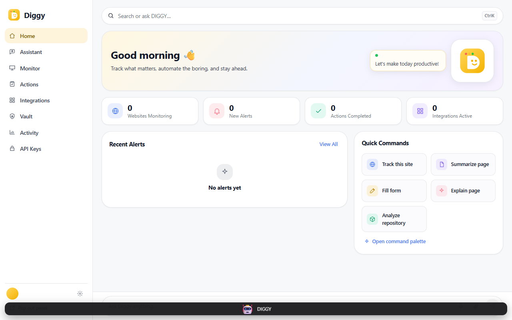
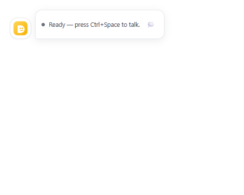

<p align="center">
  
</p>

<h1 align="center">Diggy 2.0</h1>

<p align="center">
  A personal AI browser companion that lives in your browser,<br />
  understands the page, monitors the web for you, and helps you act.
</p>

<p align="center">
  <a href="https://github.com/Ayushkumarpatel-AKP/diggy-2.o/actions/workflows/ci.yml"></a>
  
  
  =22.13" />
  
  
  
  
  
</p>

---

## Running in Chrome (actual build)



> Real capture: built MV3 extension (`apps/extension/.output/chrome-mv3`) loaded
> unpacked in Chromium, `sidepanel.html` open on a fresh profile — Home dashboard
> with nav, greeting, stats, Recent Alerts and Quick Commands.



> Real capture: `overlay.html` — the on-page status bubble beside the avatar
> (`Ready — press Ctrl+Space to talk`). The 3D avatar mounts on pages via the
> content script once host access is granted at runtime.

## What is Diggy?

Diggy is a Chromium side-panel companion with a 3D avatar:

- **Understands the page** — summarize, explain, extract info, find related opportunities.
- **Monitors the web** — track sites, keywords, content changes, deadlines and new posts.
- **Acts with approval** — fill forms (never auto-submit), open sites, create reminders.
- **Remembers safely** — encrypted vault for personal info, auto-fill only with consent.
- **Stays transparent** — every read / fill / open / monitor event lands in Activity.

## POC: user workflow

A typical proof-of-concept run, end to end:

### Step 1 — Ask about the current page
Open the **Assistant** tab and hit **Summarize this page**.
Diggy reads the active tab and returns a short summary with links, thumbnails, and follow-up actions (`Track this page`, `Extract important info`).

### Step 2 — Track what matters
Hit **Track This Website** or go to **Monitor → + Add Website**.
Pick signals: Keywords, Content Change, New Posts, Registration, Deadlines.
Example: `SIH Results Portal`, `NASA Space Apps`, `Internshala`.

### Step 3 — Get notified, not spammed
**Home → Recent Alerts** and the Monitor engine surface only meaningful changes
(`Results page updated • 10 min ago`) with urgent flags and dedupe.

### Step 4 — Let Diggy act (with approval)
**Quick Actions**: Summarize Page, Fill Form, Explain This.
**Actions tab** records every run: `Filled Internship Form`, `Summarized PDF`,
`Created Reminder`, `Opened Website` — Completed / Scheduled / Failed.

### Step 5 — Connect tools
**Integrations**: Gmail, Calendar, GitHub, Notion, LinkedIn, YouTube, LeetCode.
OAuth tokens stay server-side; the extension never bundles provider keys.

### Step 6 — Vault + Activity = trust
**Vault** stores personal info, education, skills, resume, links for one-click
auto-fill. Locked values never leave the device.
**Activity** is the audit trail: what was summarized, filled, opened, monitored — and when.

## Features

| Area | What you get |
|---|---|
| Home | Greeting, monitoring stats, recent alerts, quick actions |
| Assistant | Page Q&A, summaries, extract, related opportunities, voice input |
| Monitor | Websites / GitHub / Others, per-site signals, Active state |
| Actions | Full history with status filters + New Action |
| Integrations | Productivity, Development, Social connectors |
| Vault | Personal info, education, skills, resume, links, custom fields |
| Activity | Timestamped transparency log with Today filter |
| Avatar | three.js + VRM character, 12-state machine, push-to-talk voice, lip-sync |
| Safety | Never auto-submit, approval for irreversible steps, blocklist, vault stays local, page text is data (never instructions), no CAPTCHA/OTP bypass |

## Architecture

```text
Side Panel (React + Tailwind)
  └─ Assistant / Monitor / Actions / Integrations / Vault / Activity / Home
Content Script + Background (MV3) + Offscreen audio
  └─ Tab registry, pointer overlay, voice approval, URL guard
packages/core — provider failover (Groq → NVIDIA NIM), orchestrator, memory
packages/page-agent + packages/policy — Action Engine + safety gates
packages/monitor — watches, change detection, dedupe, alerts
packages/vault + packages/forms — encrypted vault + smart fill
services/crawler (Crawlee + Playwright) + services/api (Fastify + SQLite)
e2e (Playwright) + evals (recorded agent harness)
```

## Quickstart

```bash
# This machine exports NODE_ENV=production, which makes pnpm skip devDependencies.
NODE_ENV=development pnpm install          # PowerShell: $env:NODE_ENV="development"; pnpm install

pnpm -w typecheck
pnpm -w test
pnpm -w build
pnpm --filter @diggy/extension build       # → apps/extension/.output/chrome-mv3
pnpm --filter @diggy/demo dev              # design gallery
```

1. Load `apps/extension/.output/chrome-mv3` unpacked in Chrome.
2. Provider keys live **server-side only** — never in the extension bundle (see `.env.example`).
3. Run the demo gallery (`apps/demo`) for a visual review of every screen.

## Monorepo layout

| Path | What |
|---|---|
| `apps/extension` | MV3 extension (side panel, overlay, offscreen audio, content script) |
| `apps/demo` | Vite gallery of every screen/component |
| `packages/shared` | contracts (provider/avatar/monitor/action/vault/bus/activity/nav) + bus/storage + tokens |
| `packages/core` | the brain: provider failover, orchestrator, prompt, memory, skills |
| `packages/avatar` | FBX avatar engine + 12-state machine + VRM fallback |
| `packages/ui` | pastel + gold design system, 7-tab dashboard, command palette, status bubble |
| `packages/monitor` | the Monitor Engine (watches, change detection, dedupe, alerts) |
| `packages/page-agent` + `packages/policy` | Action Engine + safety gates |
| `packages/vault` + `packages/forms` | encrypted vault + smart form filling (never submits) |
| `packages/voice` | push-to-talk core, STT/TTS, lip-sync feed |
| `packages/activity` | transparency log |
| `packages/service-auth` | Node-only per-install auth for local services |
| `services/crawler` | Crawlee + Playwright + Readability, Jina, optional Python extractor |
| `services/api` | Fastify API: OAuth, encrypted tokens, packs, MCP connectors |
| `e2e/` · `evals/` | Playwright end-to-end + agent evaluation harness |
| `diggy motion/` | official FBX avatar, clips, textures, theme + logo PNGs |
| `docs/` | README assets (`logo.png`, `screenshots/dashboard.png`) |

## Design & assets

- Avatar: `assets/avatar/diggy_U.vrm` + animation clips in `assets/avatar/animations/` (source: `vrm animation/`). See [`ANIMATIONS.md`](ANIMATIONS.md).
- UI source of truth: `diggy motion/Diggy Pastel Productivity Dashboard.png`; logo: `Cheerful Golden D Mascot Logo.png`. Web-optimized copies live in `docs/`.

## Quality gates

CI (`.github/workflows/ci.yml`) mirrors local gates on Node 22 + pnpm 9.15:

`typecheck → test → build → MV3 extension build → agent evals → Playwright e2e`

## Safety rules (always on)

Never auto-submit · human approval for irreversible steps · sensitive-site blocklist ·
locked vault values never leave the device · page text is data, not instructions ·
no CAPTCHA/OTP bypass.

## Roadmap

- [ ] More connectors (Calendar sync, Notion actions, LeetCode tracking)
- [ ] Smarter alert ranking and digest mode
- [ ] Avatar expression + animation polish
- [ ] Pack sharing via `services/api` MCP connectors
